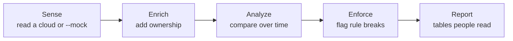
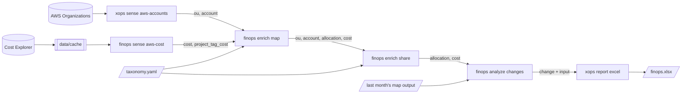
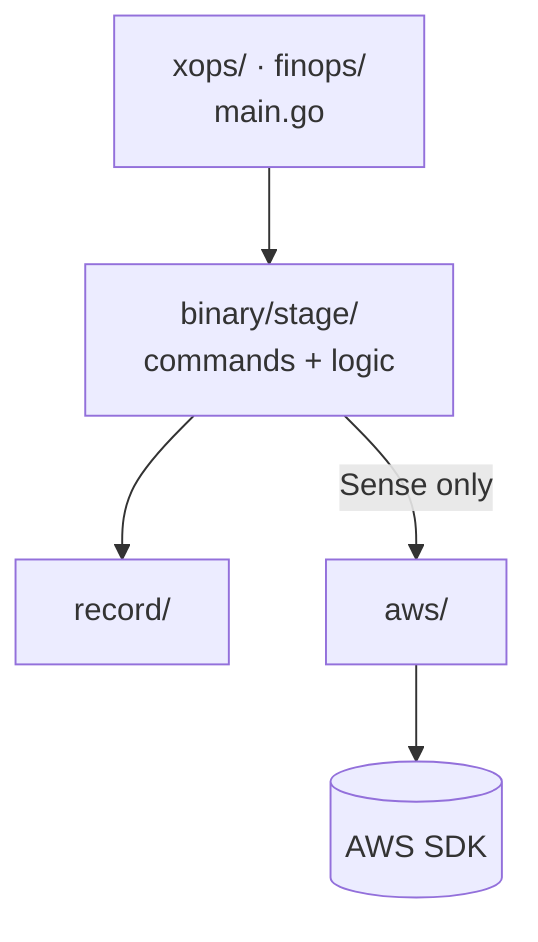

# Architecture — how OpenXOps fits together

Read this after [`AGENTS.md`](../AGENTS.md) and before any Work Item. It explains the concepts
behind the decisions and contracts in one place, so a new agent can find its way around.

**This file explains and links; it does not decide.** The source of truth is
[`DECISIONS.md`](DECISIONS.md) for rules and each Work Item's **Contracts** for interfaces and
record fields. If this file disagrees with either, they win. Report the mismatch so Claude can
fix this file. Release order and scope are in [`RELEASES.md`](RELEASES.md).

## 1. The idea in one paragraph

OpenXOps is a set of small command-line tools for one organization's cloud operations. Each
command does one job, reads and writes flat JSON Lines records, and chains with the others
through `|` or through files. One run of a pipeline answers questions such as "who owns every
dollar of our AWS bill?". Cost (FinOps) on AWS comes first; security (SecOps), operations
(CloudOps) and other clouds use the same design later
([D-001](DECISIONS.md#d-001), [D-004](DECISIONS.md#d-004)).

## 2. Five stages, several binaries

Every command is `<binary> <stage> <thing>`, and each stage feeds the next
([D-004](DECISIONS.md#d-004)):



| Stage | Job | Never does |
|---|---|---|
| Sense | Reads a cloud (or `--mock`) and emits raw records | Interpret ownership |
| Enrich | Adds taxonomy context: who owns the cost, how shared cost splits | Call a cloud |
| Analyze | Compares and grades over time | Change amounts |
| Enforce | Flags what breaks a rule: what, where, the cost it touches, the action, the owner | **Change the cloud** ([D-010](DECISIONS.md#d-010)) |
| Report | Turns records into table, CSV or Excel | Sum or group ([WI-0106](DD-01-r1-finops-aws/WI-0106-Report.md)) |

| Binary | Holds | Examples |
|---|---|---|
| `xops` | Commands every domain shares | `xops sense aws-accounts`, `xops sense focus-cost`, `xops report excel` |
| `finops` | Cost | `finops sense aws-cost`, `finops enrich map`, `finops analyze changes` |
| `secops`, `cloudops` | Later domains | — |

**The cloud is part of the thing's name** (`aws-accounts`, later `azure-…`). Every cloud's Sense
command emits the same record kinds, so every stage after Sense works for any cloud
([D-005](DECISIONS.md#d-005)).

## 3. Records: the only interface between commands

Commands know nothing about each other. They agree only on records
([D-006](DECISIONS.md#d-006), [WI-0101 Contracts](DD-01-r1-finops-aws/WI-0101-Skeleton.md#records-d-006)):

- **UTF-8 JSON Lines, flat.** One object per line, values are scalars only (no nested objects
  or arrays), `snake_case` field names, and a `kind` on every record.
- **Pass-through.** A command passes on every record whose `kind` it doesn't handle, unchanged
  and in order, after its own output. That lets one stream carry several kinds down a pipeline.
- **Inputs.** Records come in through the pipe, through `--from-<kind> FILE`, or both. If the
  same kind arrives both ways, that is an error. `--from-history FILE` is the command's own
  earlier output.
- **Findings, not failures.** Data problems become `finding` records (`severity`, `code`,
  `subject`, `message`, `command`), and the command still exits 0. Only bad input or a bug
  exits 1, with an error that names the file and line number.
- **Only Report** writes anything other than JSON Lines.

### Record kinds (Release 1)

| `kind` | Written by | Read by | One per | Contract |
|---|---|---|---|---|
| `ou` | `xops sense aws-accounts` | `map`, passes through | OU (root included) | [WI-0102](DD-01-r1-finops-aws/WI-0102-Aws-Accounts.md#records) |
| `account` | `xops sense aws-accounts` | `map`, `changes` | account | [WI-0102](DD-01-r1-finops-aws/WI-0102-Aws-Accounts.md#records) |
| `project_tag_cost` | `finops sense aws-cost` | `map` (checks it, then drops it) | account × Project tag × period | [WI-0103](DD-01-r1-finops-aws/WI-0103-Aws-Cost.md#records) |
| `cost` | `finops sense aws-cost`; fields added by `map` and `share` | `map`, `share`, `changes`, `report` | account × service × App tag × period | [WI-0103](DD-01-r1-finops-aws/WI-0103-Aws-Cost.md#records) |
| `allocation` | `finops enrich map` | `share`, `changes` | account × App | [WI-0104](DD-01-r1-finops-aws/WI-0104-Enrich-Map.md#finops-enrich-map---taxonomy-file---from-accounts-file---from-cost-file) |
| `change` | `finops analyze changes` | `report` | difference between two `map` outputs | [WI-0107](DD-01-r1-finops-aws/WI-0107-Analyze-Changes.md#contracts) |
| `finding` | any command | `report` | problem found | [WI-0101](DD-01-r1-finops-aws/WI-0101-Skeleton.md#records-d-006) |

A `cost` record gains fields as it moves down the pipeline, and its `amount` changes only
where `share` splits it:

```
aws-cost : account_id service app_tag period metric amount currency estimated …
+ map    : lz environment environment_rule shared   (+ project app business_unit cost_center app_rule if not shared)
+ share  : the five ownership fields for shared accounts, share, share_rule, source_amount
```

## 4. Release 1 data flow



The same pipeline runs offline with `--mock` on every Sense command. That is release
criterion 2 in [DD-01](DD-01-r1-finops-aws/DELIVERABLE.md#release-criteria).

## 5. The ownership model (FinOps)

Cost is owned through a **taxonomy**, a YAML file in git
([WI-0104](DD-01-r1-finops-aws/WI-0104-Enrich-Map.md#taxonomy-file)):

```
BusinessUnit ─► Project ─► App ─► Environment      CostCenter ◄─ App
LZ (landing zone) = one AWS Organization, known by its management account
```

- **The mapping wins over tags** ([D-009](DECISIONS.md#d-009)). An account's App and
  Environment come from the taxonomy. A `Project` tag that disagrees only raises a finding.
- **Resolution, first answer wins** ([D-015](DECISIONS.md#d-015)): the account's own entry ›
  the deepest OU link › the LZ default › the global default › `UNALLOC`. App and Environment
  resolve separately, and every result records the rule that made it (`account`, `ou:<path>`,
  `lz-default`, `default`, `unalloc`).
- **Shared accounts** serve several Apps. `share` splits their cost by the `App` tag: untagged
  cost splits equally, multi-App tags split equally, and wrong tags go to `APP-INVALID`. Total
  cost in always equals total cost out ([D-016](DECISIONS.md#d-016), [D-021](DECISIONS.md#d-021)).
- **System nodes** end in `-UNALLOC` (nothing matched), `-UNSPEC` (App known, Environment not)
  or `-INVALID` (a tag points at the wrong App). The taxonomy file may not use these endings.
  Every system node comes with a finding that says why.

## 6. Code layout

([D-012](DECISIONS.md#d-012), [WI-0101 Layout](DD-01-r1-finops-aws/WI-0101-Skeleton.md#layout-d-012))

```
xops/main.go, finops/main.go   the binaries: build the root command, add each stage's Commands()
<binary>/<stage>/              a stage's commands, its plain logic functions, its testdata/
record/                        JSON Lines reader and writer, input assembly, findings, common flags
aws/                           AWS config, retry wrapper, clients behind interfaces, mock data
scripts/check/                 the Verify command: build, vet, gofmt -l, test
```



Each stage package has two layers ([D-013](DECISIONS.md#d-013)):

1. **Logic.** Plain functions: records in, records out, no I/O, no globals. Tests and the
   reference cases call these directly.
2. **Command.** Reads flags and files, calls the logic, and writes records to stdout and logs
   to stderr. Nothing else.

There is no `cmd/`, no `internal/` and no top-level `testdata/`. A package has at most 5
non-test `.go` files. The CLI library is `spf13/cobra` (chosen in WO-0101-A).

## 7. Cross-cutting rules

| Concern | Rule | Source |
|---|---|---|
| Debugging | Every command runs alone from `--from-<kind>` files and `--mock`, and has a Task and a `.vscode/launch.json` entry | [D-013](DECISIONS.md#d-013) |
| Logging | `log/slog` to **stderr** with `--log-level` (default `warn`); stdout carries records only | [D-013](DECISIONS.md#d-013) |
| Cloud calls | Through the provider folder's retry wrapper; read every page; at most 5 at once | [AGENTS.md §5](../AGENTS.md#5-engineering-rules) |
| Cost Explorer | Every call goes through the cache (each costs $0.01). A closed period is fetched once; an open one is reused for 12 h | [D-007](DECISIONS.md#d-007), [WI-0103](DD-01-r1-finops-aws/WI-0103-Aws-Cost.md#cache-d-007) |
| Storage | Local and embedded only, under gitignored `data/`. No database servers. DuckDB arrives in Release 2 | [D-007](DECISIONS.md#d-007), [D-022](DECISIONS.md#d-022) |
| Offline | Every cloud command has `--mock`, fed by deterministic fixtures embedded in the binary | [AGENTS.md §5](../AGENTS.md#5-engineering-rules) |
| Determinism | The same input gives the same output, byte for byte (golden files) | [WI-0102](DD-01-r1-finops-aws/WI-0102-Aws-Accounts.md#records) |
| Tenancy | Single tenant: no tenant field, flag or file suffix anywhere | [AGENTS.md §5](../AGENTS.md#5-engineering-rules) |
| Platform | Linux first; Windows CI is an optional early warning | [D-025](DECISIONS.md#d-025), [D-026](DECISIONS.md#d-026) |
| Licence | FSL-1.1-Apache-2.0; no code under a conflicting licence | [D-023](DECISIONS.md#d-023), [D-024](DECISIONS.md#d-024) |

## 8. How the design grows

New work always starts as a decision and a Work Order ([`README.md`](README.md)). These are the
shapes the design was built for:

- **A new cloud.** Add a provider folder (`azure/`) with its own retry wrapper, clients and
  mock, plus Sense commands named for that cloud (`xops sense azure-…`). They emit the existing
  kinds (`ou`, `account`, `cost`), so Enrich, Analyze and Report work unchanged.
- **Cost from FOCUS.** `xops sense focus-cost` turns any cloud's FOCUS export into `cost`
  records, so later stages don't care where cost came from ([D-014](DECISIONS.md#d-014)).
- **A new rule or check.** One Enforce command per rule. It emits records with the problem,
  the cost it touches, the action and the owner, and several such commands can run in one
  pipeline ([D-010](DECISIONS.md#d-010)).
- **A new domain.** A new binary (`secops/`) with the same five stages, reading `xops` Sense
  output and writing through `xops report`.
- **A new kind.** Only when no existing kind fits. It is defined once, in the Contracts section
  of the Work Item that writes it, and added to the table in §3.

## 9. Glossary

| Term | Meaning |
|---|---|
| LZ | Landing zone: one cloud organization, identified by its management account |
| OU | Organizational unit in AWS Organizations; named by ID (`ou-…`) or path (`/Workloads/Checkout`) |
| Shared account | An account whose taxonomy entry lists two or more Apps; `share` splits its cost |
| Finding | A record reporting a data problem; the command still succeeds |
| Reference case | Input plus expected output for a rule, in a package's `testdata/cases/`; tests read it unchanged |
| Closed / open period | A period whose cost no longer changes (cached for good), or one that can still change (reused for 12 h) |
| FOCUS | FinOps Open Cost and Usage Specification, a common billing export format |
