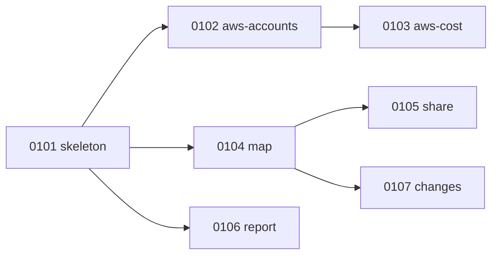

# Releases — what ships when

Read this to know which release a piece of work belongs to and what is still undecided. Concepts
are in [`ARCHITECTURE.md`](ARCHITECTURE.md). Live progress is in [`STATUS.md`](STATUS.md).

**This file summarizes; it does not decide.** A release is decided by the decisions it cites
and specified in its `DD-NN-<slug>/DELIVERABLE.md`. If this file disagrees with them, they
win.

## How a release works

1. **Grill.** Claude asks the repo owner 3–5 questions per turn, then records the answers as
   decisions ([`README.md`](README.md#grill-before-spec)).
2. **Specify.** Claude writes the Deliverable and its Work Items, with Contracts and reference
   cases.
3. **Build.** Work Orders are dispatched as issues, claimed, built, reviewed and merged one PR at
   a time ([`AGENTS.md` §4](../AGENTS.md#4-the-loop-for-one-work-order)).
4. **Close.** When the last Work Order merges, the release criteria are checked, Claude writes
   each Work Item's `Delivered (as built)` section, and the repo owner tags the release.

A release is only specified once the one before it is fully decided. Anything beyond the next
release is direction, not a commitment.

## Overview

| Release | Deliverable | Theme | State |
|---|---|---|---|
| 1 | [DD-01](DD-01-r1-finops-aws/DELIVERABLE.md) | AWS cost owned by Project › App › Environment, in Excel | Specified; building |
| 2 | not written yet | FOCUS, history, trend and impact | Scope decided (D-032 to D-036); not specified |
| 3 | not written yet | Enforce | First rules decided (D-033) |
| Later | — | More clouds, SecOps, CloudOps | Direction only |

## Release 1 — AWS cost owned by Project › App › Environment

**Decided by** [D-018](DECISIONS.md#d-018), [D-021](DECISIONS.md#d-021) and
[D-022](DECISIONS.md#d-022). **Specified in** [DD-01](DD-01-r1-finops-aws/DELIVERABLE.md).

A FinOps analyst goes from AWS to an Excel workbook in which every dollar is owned by
Project › App › Environment. Shared accounts are split by the App tag, unmapped cost shows as
`UNALLOC` with the reason, and month-on-month mapping changes are listed.

| Work Order | Delivers | Depends on |
|---|---|---|
| [WO-0101-A](DD-01-r1-finops-aws/WI-0101-Skeleton.md) | `xops`, `finops`, `record/`, `scripts/check`, CI, Task, VS Code, `docs/develop.md` | — |
| [WO-0102-A](DD-01-r1-finops-aws/WI-0102-Aws-Accounts.md) | `xops sense aws-accounts`, demo organization | 0101 |
| [WO-0103-A](DD-01-r1-finops-aws/WI-0103-Aws-Cost.md) | `finops sense aws-cost`, two-level Cost Explorer, cache, mock | 0102 |
| [WO-0104-A](DD-01-r1-finops-aws/WI-0104-Enrich-Map.md) | Taxonomy, `finops enrich validate` and `map` | 0101 |
| [WO-0105-A](DD-01-r1-finops-aws/WI-0105-Enrich-Share.md) | `finops enrich share` | 0104 |
| [WO-0106-A](DD-01-r1-finops-aws/WI-0106-Report.md) | `xops report table\|csv\|excel` with appending | 0101 |
| [WO-0107-A](DD-01-r1-finops-aws/WI-0107-Analyze-Changes.md) | `finops analyze changes` | 0104 |

Once WO-0101-A merges, three Work Orders can run at once: 0102, 0104 and 0106 touch different
packages. Release 1 is done when the six
[release criteria](DD-01-r1-finops-aws/DELIVERABLE.md#release-criteria) hold: a mock pipeline
from a clean clone, every reference case passing unchanged, cost conserved after `share`, zero
Cost Explorer calls on a cached rerun, and a run against the real Organization with read-only
permissions.

**Not in Release 1:** DuckDB, FOCUS, trend, impact, Enforce, the history store,
`--as-reported`, and any cloud but AWS.

## Release 2 — FOCUS, history, trend and impact

**Scope decided by** [D-032](DECISIONS.md#d-032) to [D-036](DECISIONS.md#d-036), with
[D-014](DECISIONS.md#d-014), [D-017](DECISIONS.md#d-017) and [D-022](DECISIONS.md#d-022). Not
yet specified: there is no `DD-02` folder and no Work Item.

| Capability | Command | Already decided |
|---|---|---|
| FOCUS export | `finops sense aws-focus` | Opt-in; reads the FOCUS export from the bucket and prefix in the LZ's `focus` entry ([D-014](DECISIONS.md#d-014), [D-035](DECISIONS.md#d-035)) |
| FOCUS to cost | `xops sense focus-cost` | Any cloud's FOCUS rows become `cost` records, adding region, `Feature` and other tags ([D-014](DECISIONS.md#d-014)) |
| History | `data/history/<command>/<run>.jsonl`, `--as-reported` | Record files, written once, kept forever; DuckDB reads them ([D-034](DECISIONS.md#d-034), [D-007](DECISIONS.md#d-007)) |
| Trend | `finops analyze trend` | Monthly, on **average daily cost**; 3-month baseline, or fewer; `trend-no-baseline` with none ([D-035](DECISIONS.md#d-035)) |
| Impact | `finops analyze impact` | Floor 30; levels at factor ≥ 2, 4, 8, 16, on average daily cost; new, ongoing or resolved against history ([D-017](DECISIONS.md#d-017), [D-035](DECISIONS.md#d-035)) |
| Embedded SQL | DuckDB, CGO, build tag `no_duckdb_arrow` | Arrives with FOCUS ([D-022](DECISIONS.md#d-022)) |

`aws-cost` stays the default source of cost; FOCUS adds detail when asked for.

**Still to grill before `DD-02` is written:** the FOCUS file format and how it is fetched, which
commands save history and how, `--as-reported` details, and how deep each trend hierarchy goes.

## Release 3 — Enforce

**Decided by** [D-032](DECISIONS.md#d-032) and [D-033](DECISIONS.md#d-033). One command per rule,
flags only, never changes the cloud ([D-010](DECISIONS.md#d-010)). First rules: untagged shared
cost, unallocated cost above a threshold, and Project tag mismatch, each with its action and
owner. Thresholds and record format are grilled when Release 3 starts.

## Later — direction only

These follow from the design ([D-004](DECISIONS.md#d-004), [D-005](DECISIONS.md#d-005)), but
none has a decided scope, order or date:

- **Other clouds:** `azure/`, `gcp/`, `oci/` provider folders, with Sense commands emitting the
  existing kinds; FOCUS (`focus-cost`) is the shortest path for cost.
- **SecOps** (`secops`) and **CloudOps** (`cloudops`): new binaries with the same five stages.
- **Commercial packaging** (a hosted version, commercial licences): kept open by
  [D-023](DECISIONS.md#d-023); needs a CLA first.

Each item becomes a release only after its own grill and decisions.
